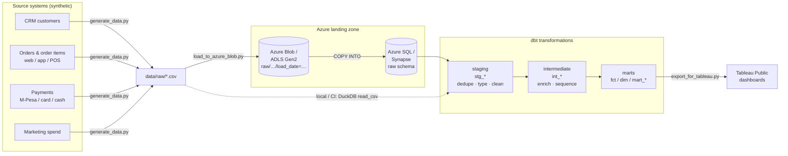
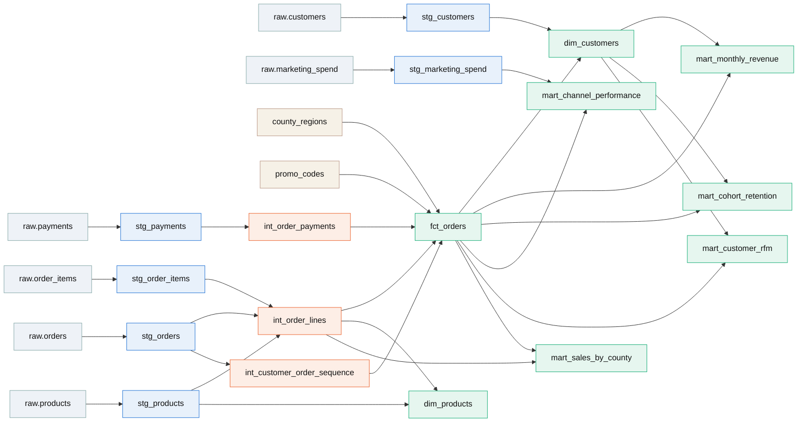
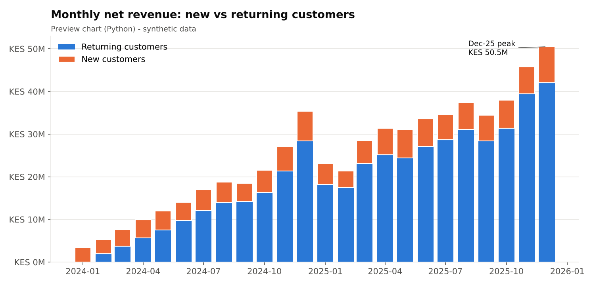
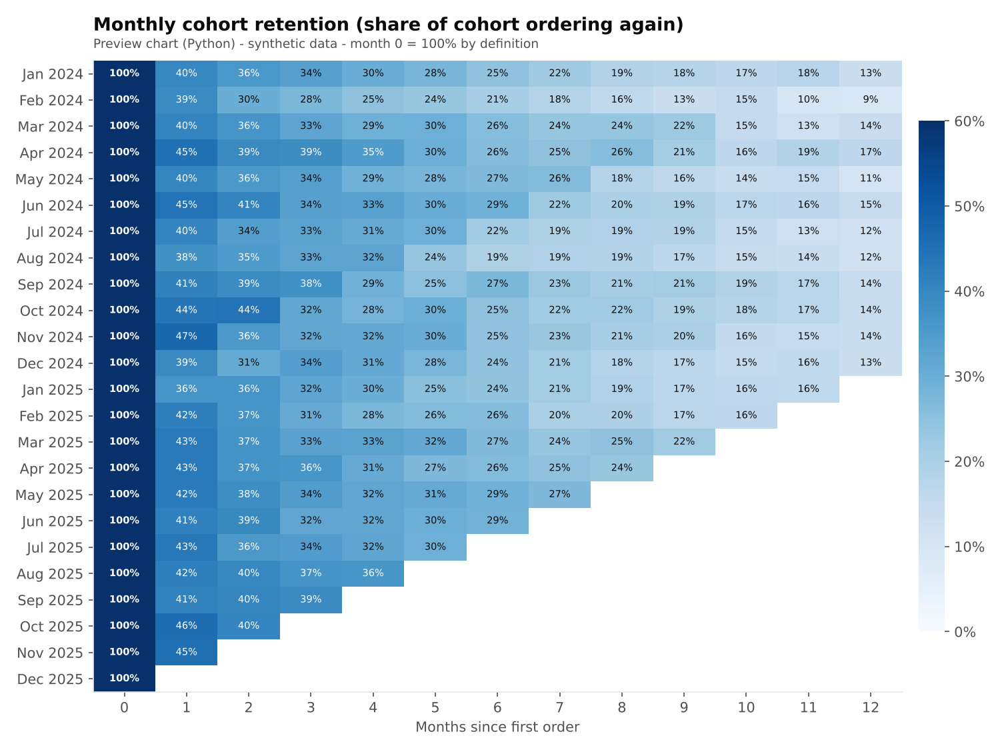
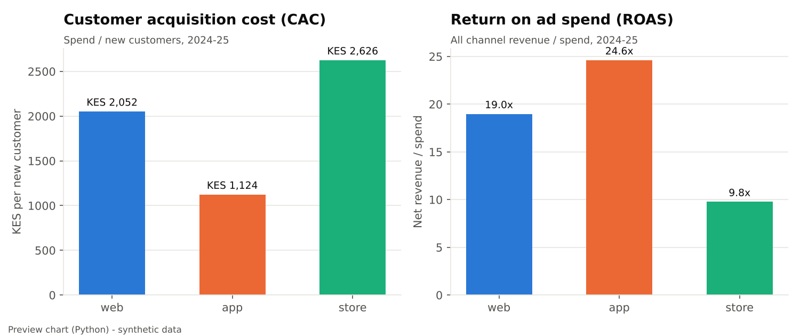
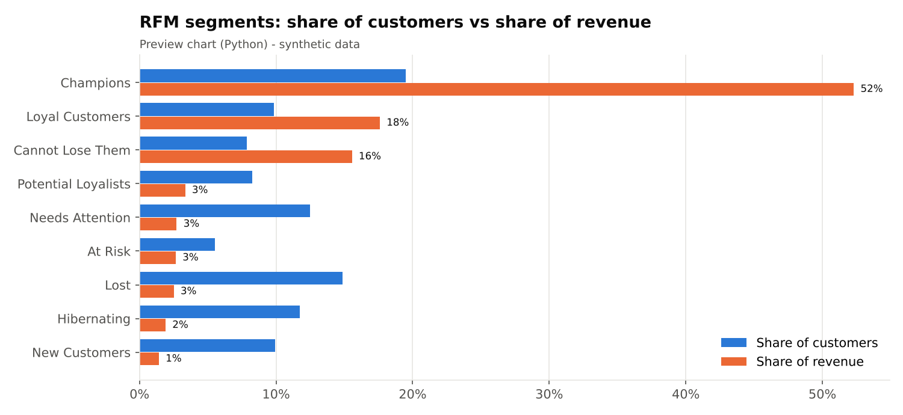

# Kenya Retail Sales Analytics — dbt + Azure + Tableau

**Turning messy omnichannel sales data (web, app, stores, M-Pesa payments) into tested, documented revenue, retention and marketing-ROI models that a business team can trust.**

[](https://github.com/JoMatata/retail-analytics-dbt-azure/actions/workflows/dbt-ci.yml)


> **Data notice:** all data in this repository is **synthetic**, generated by
> [`scripts/generate_data.py`](scripts/generate_data.py) for a fictional retailer. Names, phone numbers,
> emails and sales are fake. The business patterns below come from the simulation's assumptions — the point
> of the project is the engineering and the analysis method, not claims about the Kenyan market.

**Tableau Public dashboard:** link coming — build spec in [`tableau/DASHBOARD_SPEC.md`](tableau/DASHBOARD_SPEC.md).

---

## The business problem

A Kenyan retailer launched a unified omnichannel platform in January 2024: an e-commerce site, a mobile app
and POS-linked loyalty accounts in its stores, all paid with **M-Pesa**, card or cash. Two years later the
data is spread across CRM, order, payment and marketing exports — with duplicates, inconsistent spellings and
missing values — and leadership is asking:

1. How fast is revenue growing, and how much comes from **returning** vs **new** customers?
2. Do customers come back? What does **monthly cohort retention** look like?
3. Which acquisition channel gives the best **CAC** and **ROAS**?
4. Who are our most valuable customers, and who are we about to lose (**RFM**)?

## Architecture



The same dbt project runs in two places:

* **Locally and in CI** on **DuckDB** — reads the CSVs directly, builds and tests everything in ~30 seconds.
* **On Azure** — raw files land in **Blob Storage / ADLS Gen2**, are bulk-loaded into a `raw` schema in
  **Azure SQL Database** or a **Synapse** dedicated pool, and dbt runs against that warehouse via the
  `azure` / `synapse` targets in [`profiles.example.yml`](profiles.example.yml).

## Tech stack

| Layer | Tool | Why |
|---|---|---|
| Data generation | Python, NumPy, pandas | Seeded, reproducible synthetic data with realistic seasonality, churn and dirt |
| Landing zone | Azure Blob Storage / ADLS Gen2 (`azure-storage-blob`) | Cheap, partitioned raw file store (`load_date=` folders) |
| Warehouse | DuckDB (dev/CI) · Azure SQL / Synapse (cloud) | Same models, different target |
| Transformation | dbt Core (`dbt-duckdb`, `dbt-sqlserver` / `dbt-synapse`) | Layered models, tests, docs, lineage, incremental loads, snapshots |
| CI | GitHub Actions | `dbt build` on every push / PR |
| BI | Tableau Public (+ matplotlib previews) | Executive, retention and channel dashboards |

## Data model



| Model | Grain | What it answers |
|---|---|---|
| `fct_orders` | order | **Incremental** order fact: amounts, margin, payment outcome, promo validity, new vs returning |
| `dim_customers` | customer | Region, acquisition channel, cohort, lifetime value, lifecycle status |
| `dim_products` | product | Category, list margin, lifetime sales |
| `mart_monthly_revenue` | month | Revenue, orders, AOV, margin, new vs returning customers & revenue, returns, MoM/YoY |
| `mart_cohort_retention` | cohort month × months since first order | Retention rate and revenue per cohort customer |
| `mart_channel_performance` | month × channel | Spend, new customers, **CAC**, **ROAS**, first-order ROAS |
| `mart_customer_rfm` | customer | R/F/M scores and named segments |
| `mart_sales_by_county` | month × county × channel × category | Geography and category mix for Tableau |

Run `make docs` to browse the full dbt docs site and lineage graph.

**Definitions.** Revenue = net of promo discounts, **completed orders only** (cancelled and returned orders
excluded). A *new* customer is one whose first completed order falls in the period. CAC = paid media spend ÷ new
customers acquired through the channel. ROAS = channel net revenue ÷ spend.

## Key insights

All figures are computed by the dbt marts from the synthetic data (Jan 2024 – Dec 2025).

| KPI (2024–2025) | Value |
|---|---|
| Net revenue | **KES 600.1M** (2024: 190.5M · 2025: 409.5M) |
| Completed orders | **136,083** |
| Average order value | **KES 4,410** |
| Gross margin | **22.8%** |
| Purchasing customers | **19,315** of 20,000 sign-ups |



1. **Growth is being carried by repeat customers.** Revenue more than doubled in 2025 (+115%, mostly because
   2024 was the launch ramp), and the share of revenue from returning customers rose from **70.8% in 2024 to 82.1% in
   2025**. December is the peak month (Dec 2025: **KES 50.5M**, +43% YoY), driven by Black Friday and Jamhuri promos.
2. **Retention drops off sharply after the first order.** Weighted across all cohorts, **42.1%** of new customers buy again
   in month 1, **34.0%** in month 3, **25.5%** in month 6 and **13.2%** in month 12. The month 1 step is where
   onboarding and second-purchase incentives would pay off most.
3. **The app is the most efficient acquisition channel.** App CAC is **KES 1,124**, against **KES 2,052** for web and
   **KES 2,626** for stores, and it fell from KES 1,240 (2024) to KES 1,061 (2025). App-acquired customers also repeat more
   (**64.3%** place a second order vs 54.6% web, 50.8% store). The trade-off is basket size: app AOV is **KES 3,252**
   against KES 6,158 on web.
4. **Stores have the weakest paid-media payback.** Store ROAS is **9.8x** overall but only **1.6x** on first-order
   revenue, compared with ~2.9x for web and app. That makes radio/outdoor spend the first candidate for reallocation tests.
5. **A fifth of customers drive half the revenue.** RFM *Champions* are **19.5%** of customers and **52.3%** of revenue.
   **1,518** *Cannot Lose Them* customers (high value, not seen recently) hold **15.6%** of lifetime revenue and are
   the priority win-back list.
6. **The revenue mix leans towards low-margin categories.** Electronics brings in **46.3%** of net revenue at an **11.3%** gross
   margin, while Fashion (49.0% margin) and Home & Kitchen (35.7%) are under-weighted. Moving a small share of the mix toward
   those categories would lift blended margin.
7. **M-Pesa is the dominant way customers pay.** **67.8%** of completed orders are paid by M-Pesa, and **7%** of those
   needed a retry after a failed STK push, so checkout reliability matters.

| Cohort retention | Channel CAC & ROAS |
|---|---|
|  |  |



*The charts above are preview charts (Python / matplotlib) generated by `scripts/make_charts.py`; the interactive
version is the Tableau Public dashboard.*

## Run it locally

Requires Python 3.11+ (tested on 3.13) and `make`.

```bash
git clone https://github.com/JoMatata/retail-analytics-dbt-azure.git
cd retail-analytics-dbt-azure
python -m venv .venv && source .venv/bin/activate
make install          # pip install -r requirements.txt
make all              # generate data -> dbt build -> Tableau CSVs -> preview charts (~1 min)
make docs             # optional: dbt docs + lineage at http://localhost:8080
```

`make all` runs, in order:

| Step | Command | Output |
|---|---|---|
| Generate data | `python scripts/generate_data.py` | `data/raw/*.csv` (~150k orders, ~390k lines, gitignored) and `data/sample/` |
| Build + test | `dbt build --profiles-dir . --target dev` | `data/warehouse/kenya_retail.duckdb` |
| Export | `python scripts/export_for_tableau.py` | `tableau/data/*.csv` (each < 5 MB, no PII) |
| Charts | `python scripts/make_charts.py` | `docs/images/*.png` |

No `make`? Run the four commands in the table above, in order.

## Run it on Azure

1. **Land raw files** in Blob Storage / ADLS Gen2:
   ```bash
   pip install azure-storage-blob
   export AZURE_STORAGE_CONNECTION_STRING="DefaultEndpointsProtocol=https;AccountName=...;AccountKey=...;EndpointSuffix=core.windows.net"
   python scripts/load_to_azure_blob.py --dry-run   # preview paths
   python scripts/load_to_azure_blob.py             # -> raw/kenya_retail/<table>/load_date=YYYY-MM-DD/<table>.csv
   ```
2. **Load into the warehouse.** Create the all-text raw tables with
   [`azure/01_create_raw_tables.sql`](azure/01_create_raw_tables.sql), then bulk-load them with
   [`azure/02_copy_into_from_adls.sql`](azure/02_copy_into_from_adls.sql) (Synapse `COPY INTO`). On Azure SQL Database,
   use an ADF Copy activity or `BULK INSERT`.
3. **Run dbt against Azure.** Copy `profiles.example.yml` to `~/.dbt/profiles.yml`, install the adapter and set the env vars:
   ```bash
   pip install dbt-sqlserver          # or: pip install dbt-synapse
   export AZURE_SQL_SERVER=myserver.database.windows.net AZURE_SQL_DATABASE=retail \
          AZURE_SQL_USER=dbt_user AZURE_SQL_PASSWORD='***'
   dbt build --target azure           # or: --target synapse
   ```
   Source tables then resolve to `raw.<table>`; the DuckDB-only `external_location` setting is ignored.

> **Portability note.** The models avoid DuckDB-only SQL. They use dbt's cross-database macros (`dbt.date_trunc`,
> `dbt.datediff`, `dbt.dateadd`, `dbt.safe_cast`, `dbt.concat`, `dbt.type_timestamp`), plain `case` / `replace` /
> `trim` / window functions, and 0/1 integer flags instead of booleans. Only the DuckDB target runs in CI, though. Treat
> the Azure targets as configured but **not yet validated against a live workspace**. The YAML uses the dbt ≥ 1.10
> `arguments:` test syntax, so check that your Azure adapter version supports it.

## Tests & data quality

`dbt build` runs **169 nodes: 2 seeds, 1 snapshot, 17 models and 149 data tests**. The current result is
**PASS=168, WARN=1, ERROR=0**.

| Test type | Count | Examples |
|---|---|---|
| `not_null` / `unique` | 66 / 20 | Primary keys on every model, seeds |
| `relationships` | 9 | orders → customers, lines → products, `fct_orders` → `dim_customers` |
| `accepted_values` | 20 | channel, payment method, order status, region, RFM segment |
| Custom generic (`tests/generic/`) | 30 | `non_negative`, `value_between` (rates 0–1, scores 1–5), `unique_combination` (grain checks) |
| Singular (`tests/*.sql`) | 4 | order totals reconcile to lines · cohort month 0 = 100% · refunds ≤ payments · spend ties out source → mart |

**The one warning is intentional.** 267 orders use `FREESHIP`, a promo code that isn't in the approved `promo_codes`
seed. The relationships test runs at `severity: warn`, so these orders show up as a data-quality alert without
blocking the build, and `fct_orders.is_valid_promo = 0` flags them for analysis.

**Deliberate dirt the staging layer handles:**

| Issue in raw data | Fix (where) |
|---|---|
| Customer rows re-synced from the CRM (1.5% dupes) | Keep latest `updated_at` (`stg_customers`) |
| Duplicate order loads, replayed M-Pesa callbacks, double-loaded spend | `row_number()` / `distinct` dedupe (`stg_*`) |
| `"Web"`, `" APP"`, `"nairobi "`, `"M-Pesa"/"MPESA"/"VISA"` | `clean_text`, `normalize_payment_method` macros |
| Prices stored as `"KES 1,250.00"`, spend as `"1,234,567"` | `clean_kes_amount` macro |
| Phones as `07…`, `254…`, `+254 7xx xxx xxx`, `+254-…` | `normalize_ke_phone` macro → E.164 |
| Missing county / email / delivery county | Fall back to home county; `Unknown` region bucket |
| Missing product cost (5%) | Category average cost ratio, flagged `is_cost_estimated` |
| Zero-quantity (voided) lines | Filtered in `stg_order_items` |

Other dbt features in use: an **incremental** `fct_orders` (delete+insert with a 3-day look-back, exercised twice in CI),
a **check-strategy snapshot** of the product master (`snap_products`), **seeds** for all 47 counties mapped to their
former provinces and for the promo calendar, a custom `generate_schema_name` macro, an `rfm_segment` macro, and an
ad-hoc **analysis** (`analyses/promo_effectiveness.sql`).

## Project structure

```
retail-analytics-dbt-azure/
├── .github/workflows/dbt-ci.yml   # CI: generate data -> dbt build (DuckDB) -> incremental re-run -> export
├── Makefile                       # make all = end-to-end
├── dbt_project.yml
├── profiles.yml                   # DuckDB dev target (no secrets) for local/CI
├── profiles.example.yml           # dev + azure (Azure SQL) + synapse targets, env-var creds
├── requirements.txt
├── analyses/promo_effectiveness.sql
├── azure/                         # raw DDL + Synapse COPY INTO from ADLS
├── data/
│   ├── raw/                       # generated, gitignored
│   └── sample/                    # ~200-row extracts of each raw table (committed)
├── docs/images/                   # preview charts (Python)
├── macros/                        # cleaning, rfm_segment, generate_schema_name
├── models/
│   ├── staging/                   # _sources.yml, _stg_models.yml, stg_*.sql
│   ├── intermediate/              # int_order_lines, int_order_payments, int_customer_order_sequence
│   └── marts/                     # fct_orders, dim_*, mart_*
├── scripts/
│   ├── generate_data.py           # synthetic data generator (seeded)
│   ├── load_to_azure_blob.py      # raw CSVs -> Azure Blob / ADLS Gen2
│   ├── export_for_tableau.py      # marts -> tableau/data/*.csv
│   └── make_charts.py             # marts -> docs/images/*.png
├── seeds/                         # county_regions.csv, promo_codes.csv
├── snapshots/snap_products.yml
├── tableau/
│   ├── DASHBOARD_SPEC.md          # sheet-by-sheet Tableau build spec
│   └── data/                      # Tableau-ready extracts
└── tests/                         # singular tests + generic/ custom tests
```

## Skills demonstrated

* **Analytics engineering with dbt:** layered staging → intermediate → marts design, sources, seeds, snapshots,
  an incremental fact with a look-back window, Jinja macros, custom generic tests and full `schema.yml` documentation
* **Data quality:** 149 automated tests, reconciliation tests, a severity-tiered warning, and a staging layer built
  for real-world dirt (duplicates, casing, text-encoded amounts, phone formats)
* **Cloud data platform (Azure):** Blob/ADLS landing-zone design with partitioned paths, Synapse `COPY INTO`,
  environment-based credentials, and multi-target dbt profiles (DuckDB / Azure SQL / Synapse)
* **SQL:** window functions (`row_number`, `lag`, `ntile`), cohort math, full outer joins and cross-database portability
* **Business analytics:** revenue decomposition (new vs returning), cohort retention, CAC/ROAS unit economics,
  RFM segmentation and margin-mix analysis, all with clear metric definitions
* **BI and communication:** Tableau dashboard spec with calculated fields, plus Python preview charts and a recruiter-ready write-up
* **Engineering hygiene:** reproducible seeded data, one-command pipeline, GitHub Actions CI, no secrets in the repo

## Author

**Joan Matata** — Data Analyst / Analytics Engineer, Nairobi, Kenya

* GitHub: [@JoMatata](https://github.com/JoMatata)

Released under the [MIT License](LICENSE). The synthetic data may be reused freely.
